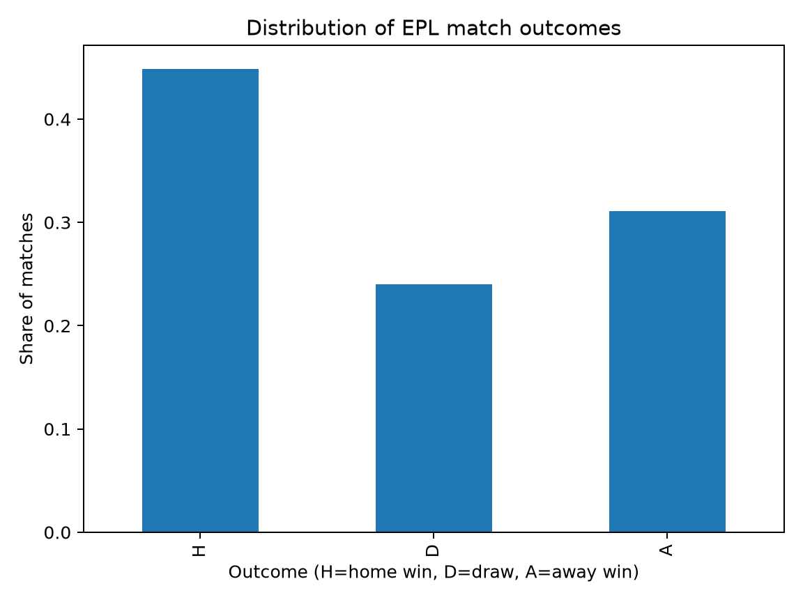
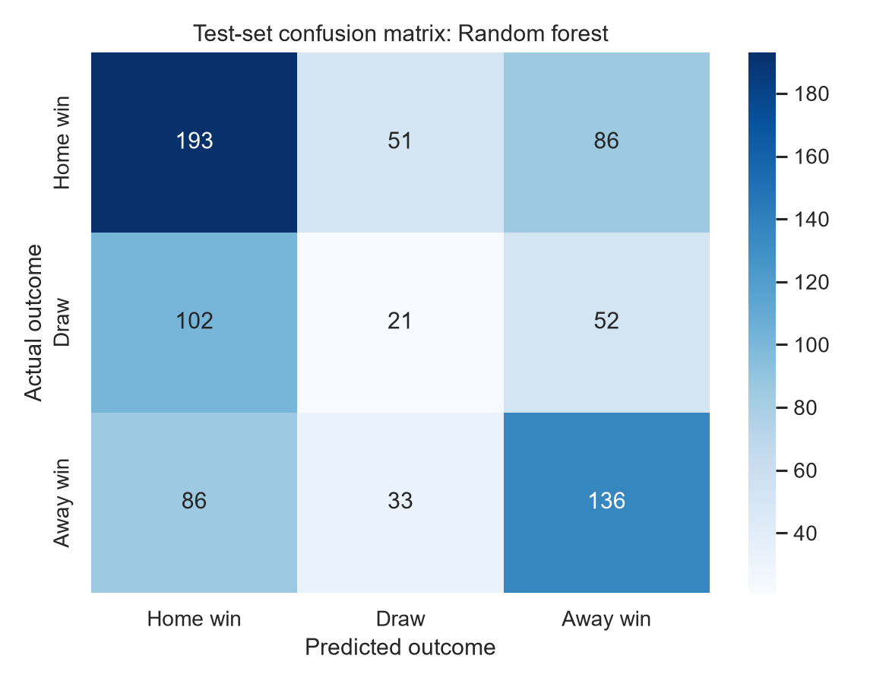

# Predicting English Premier League Match Outcomes

An end-to-end machine learning project exploring whether recent team form can help predict English Premier League (EPL) match outcomes: **home win, draw or away win**.

The project emphasises reproducible data preparation, pre-match feature engineering, chronological validation, baseline comparison and honest error analysis. It compares a majority-class baseline with multinomial logistic regression and a random forest.

## Questions

- How well can recent team form predict match outcomes?
- Does a more flexible model outperform a linear classifier?
- Which outcomes are hardest to predict?
- What are the limitations of predicting football results from historical form alone?

## Project structure

```text
 epl-match-outcome-ml/
 ├── data/
 │   ├── raw/                 # downloaded season CSVs (not committed)
 │   └── processed/           # generated modelling dataset (not committed)
 ├── notebooks/
 │   └── 01_match_outcome_analysis.ipynb
 ├── reports/                 # generated figures and metrics
 ├── src/
 │   ├── data.py              # download and validate match results
 │   ├── features.py          # pre-match rolling-form features
 │   ├── modeling.py          # temporal split, models and metrics
 │   └── run_analysis.py      # command-line workflow
 ├── tests/
 │   ├── test_data.py
 │   └── test_features.py
 ├── .gitignore
 └── requirements.txt
```

## Data

The workflow downloads season-level match-result CSVs from the [English Premier League dataset on DataHub](https://datahub.io/football/english-premier-league), which credits [Football-Data.co.uk](https://www.football-data.co.uk/). It uses match date, home team, away team, full-time home goals, full-time away goals and the full-time result. Betting odds and in-match statistics are excluded because these may not be available at prediction time.

The script uses completed seasons from **2010/11 through 2024/25**. It does not commit raw or processed match data. Review the source's current licence, attribution and redistribution terms before republishing data.

## Method

1. Download the season files, standardise dates and columns, validate full-time results against scores, and remove duplicate or unusable records.
2. Build rolling features from each club's previous five matches: points, goals for, goals against, goal difference, win rate and draw rate. Cold-start defaults are used when no history is available.
3. Build all features for a calendar date before adding any of that date's results to team history. This guards against same-day look-ahead if fixtures share a date.
4. Split chronologically rather than randomly:
   - Training: through 2020/21
   - Validation: 2021/22 and 2022/23
   - Final test: 2023/24 and 2024/25
5. Compare a majority-class baseline, logistic regression and random forest using accuracy, balanced accuracy and macro F1.
6. Select the model using validation macro F1, refit on training plus validation data, then evaluate on the held-out test seasons. The test seasons are not used for model selection.

## Results

The recorded run loaded **5,700 matches** from 14 August 2010 to 25 May 2025. The final test set contains **760 matches** from the 2023/24 and 2024/25 seasons. Metrics below come from that run; results can change if the upstream data changes or the code is modified.

### Validation comparison

| Model | Accuracy | Balanced accuracy | Macro F1 |
|---|---:|---:|---:|
| Random forest | 44.2% | 39.7% | **0.393** |
| Logistic regression | **50.3%** | **40.9%** | 0.355 |
| Majority-class baseline | 45.7% | 33.3% | 0.209 |

Random forest was selected because it achieved the highest validation macro F1. Logistic regression had higher validation accuracy, showing that the preferred model depends on the metric. Macro F1 gives equal weight to the three outcome classes.

### Held-out test comparison

| Model | Accuracy | Balanced accuracy | Macro F1 |
|---|---:|---:|---:|
| Majority-class baseline | 43.4% | 33.3% | 0.202 |
| Random forest (selected) | **46.1%** | **41.3%** | **0.402** |

The selected random forest's recall was 58.5% for home wins, 12.0% for draws and 53.3% for away wins. Draws were the most difficult class to identify. The accuracy improvement over the majority-class baseline was modest, so the results should not be described as strong prediction performance. The project is valuable as a reproducible investigation of model selection, temporal evaluation and error analysis rather than as a reliable match-prediction system.

### Generated diagnostics

The pipeline writes validation and test metrics to `reports/`, along with a class distribution chart and held-out confusion matrix. These two plots are retained in the repository as a preview of the analysis.





## Run it on Windows

Python 3.10 or later is required. Open a terminal in the repository root and run:

```powershell
py -m venv .venv
.\.venv\Scripts\python.exe -m pip install -r requirements.txt
.\.venv\Scripts\python.exe -m src.run_analysis
.\.venv\Scripts\python.exe -m pytest tests -v
```

These commands do not require activating the virtual environment in PowerShell. The workflow saves generated tables and figures in `reports/` and the processed features in `data/processed/`.

To explore the analysis interactively, launch Jupyter with `.\.venv\Scripts\python.exe -m jupyter lab` and open `notebooks/01_match_outcome_analysis.ipynb`. The notebook uses the same project functions as the command-line workflow.

## Interpretation and limitations

- Accuracy alone can be misleading when one outcome occurs more often than others, so the project also reports balanced accuracy and macro F1.
- Recent team form has some signal, but it does not capture injuries, confirmed line-ups, player quality, transfers, managerial changes or tactical differences.
- Draws are particularly hard for this model to identify.
- Historical prediction performance is not evidence of a profitable betting strategy. This project does not offer betting recommendations.
- Results depend on data quality, historical team labels and the chosen evaluation period.

## Reproducibility

- Raw and processed match data are generated locally and excluded from version control.
- The random forest uses a fixed random seed.
- The data source, seasons, feature construction and split dates are recorded in code.
- Metrics are generated by the workflow; the README reports the run recorded above.

## Potential extensions

Further work could compare the features against a home-advantage-only model, assess probability calibration, add pre-match team-strength ratings or investigate richer features. Any improvement should be evaluated chronologically without using final test seasons for model selection.
